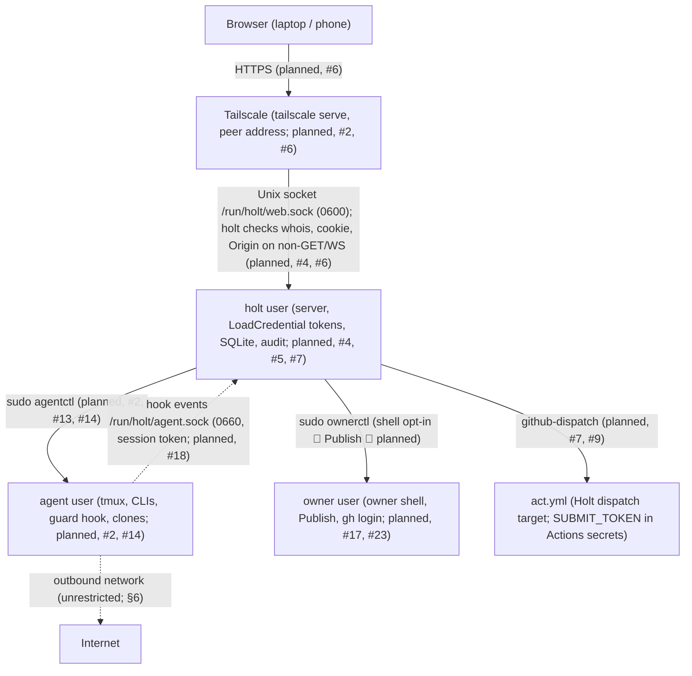

# Holt Threat Model

Status: **design baseline**. Only #1 (repo bootstrap) is complete; every Holt runtime control, script, and test below is **planned** until its linked issue lands. Verified `oss-scout` facts (at `dce9fb7`) are noted explicitly.

## 1. What Holt protects

- **Ability to post on GitHub**: in `oss-scout`, the README ("Guardrails") names `act.yml` as the GitHub writer, and `track.yml` (`scout/datarepo.py`) also invokes `scout/act.py` with `SUBMIT_TOKEN` (injected as `GH_TOKEN`) to submit owner-approved refreshed drafts. `SUBMIT_TOKEN` stays in `oss-scout-data`'s Actions secrets, `worker/src/index.js` enforces a fixed `ACTIONS` list, and `scout/act.py` re-checks every action. Holt plans to dispatch scout actions only via `act.yml` using that contract (planned, #9), keeping `oss-scout` data-branch writes in GitHub Actions.
- **Holt's service tokens**: two fine-grained GitHub tokens (`github-read` for Contents read-only on `oss-scout-data`; `github-dispatch` for Actions read/write only) and the write-only `ntfy-token`, loaded as root-owned systemd credentials (planned, #7).
- **Owner's `gh` login and SSH keys**: kept only in the separate owner Unix user's home directory (`0700`), used by the opt-in owner shell (default off, planned, #17) and the Publish flow (gated by 12-hour cookie age, text checks, workspace `.git` audit, and explicit confirmation, planned, #23).
- **Agent CLI logins**: Claude Code and Codex credentials under the `agent` Unix user (planned, #2).
- **Session terminals**: shared PTYs attached to `agent` tmux sessions and the opt-in owner shell (planned, #14, #16, #17).
- **SQLite database and audit log**: `/var/lib/holt/holt.db` (`0600`) and its append-only, hash-chained `audit` table (planned, #4, #5).

## 2. Who or what could attack

- **Prompt-injected agent session**: issue text, comments, and briefings come from strangers and are treated as untrusted data, never instructions.
- **Malicious upstream build or test script**: arbitrary code executed inside an agent clone during build or test runs (including `.git` hooks/config traps planted in shared clones, mitigated by workspace audit and `holtgit`, planned, #13).
- **Another device on the tailnet**: any tailnet peer that fails either the owner Tailscale login check or pairing-cookie auth (planned, #6).
- **Local process on the mini PC**: an unprivileged local process attempting to reach Holt's sockets, loopback, or tailnet IP (planned, #4, #6).
- **Stolen phone or browser cookie**: a lost paired device holding a `__Host-holt_session` cookie (mitigated by `holt-admin revoke` and the 12-hour fresh-cookie gate for owner shell and Publish, planned, #6, #17, #23).
- **Malicious issue rendered in the web app (XSS / terminal escapes)**: script injection in issue text or OSC 52 clipboard escapes in terminal output (mitigated by `SafeMarkdown`, strict CSP, and OSC 52 blocking, planned, #6, #10, #16).

## 3. Trust boundaries

Planned Unix-socket deployment (if `tailscale serve` lacks `unix:` support, #6 allows a `127.0.0.1` fallback where local processes can forge identity headers and the pairing cookie is the primary barrier):

## 4. Who may do what

`Local process` means a process under any other unprivileged Unix account on the mini PC (not root, the owner, `holt`, or `agent`, and outside service groups). `Other tailnet device` means any tailnet peer that does not satisfy both the owner Tailscale identity and pairing-cookie checks (a second paired owner device is in `Owner via web app`). Every `Blocked` cell names a planned control and verification (`deploy/verify-boundary.sh` in #2 and CI tests under `server/tests/boundaries/` in #27).

| Action                                | Owner via web app                                                                                                                                                          | `holt` user                                                                                                                                                                                          | `agent` user                                                                                                                                                                                                                   | Local process                                                                                                                                                                                              | Other tailnet device                                                                                                                                         |
| ------------------------------------- | -------------------------------------------------------------------------------------------------------------------------------------------------------------------------- | ---------------------------------------------------------------------------------------------------------------------------------------------------------------------------------------------------- | ------------------------------------------------------------------------------------------------------------------------------------------------------------------------------------------------------------------------------ | ---------------------------------------------------------------------------------------------------------------------------------------------------------------------------------------------------------- | ------------------------------------------------------------------------------------------------------------------------------------------------------------ |
| Start `act.yml`                       | Allowed (allowlisted actions via `POST /api/actions`; planned, #9, #26)                                                                                                    | Allowed (`github-dispatch`, allowlist + `scout/act.py` check; planned, #7, #9)                                                                                                                       | Blocked — no dispatch token, `web.sock` `0600`, `guard.py --profile agent` (`deploy/verify-boundary.sh`, CI guard test; planned, #2, #6, #7, #27)                                                                              | Blocked — `web.sock` `0600`, own-node check, no cookie/token (#4 socket check, `deploy/verify-boundary.sh`, `server/tests/boundaries/`; planned, #4, #6, #27)                                              | Blocked — tailnet `whois` allowlist + pairing cookie (`server/tests/boundaries/`; planned, #6, #27)                                                          |
| Read the scout data                   | Allowed (read-only synced `dashboard.json` API; planned, #8)                                                                                                               | Allowed (read-only `github-read` clone at `/var/lib/holt/data-repo`; planned, #7, #8)                                                                                                                | Blocked (full data; host UID can read exported briefings in `/srv/holt/briefings/`, narrowed to 1 mount in Podman #29) — `/var/lib/holt` `0700` (`deploy/verify-boundary.sh`, #14 export test; planned, #2, #14)               | Blocked — `/var/lib/holt` `0700`, `web.sock` `0600`, own-node check (`deploy/verify-boundary.sh`, `server/tests/boundaries/`; planned, #2, #4, #6, #27)                                                    | Blocked — tailnet `whois` allowlist + pairing cookie (`server/tests/boundaries/`; planned, #6, #27)                                                          |
| Read tokens (Holt's 3 service tokens) | Blocked — server never returns tokens; `Secret` + `redact()` (#7 `Secret`/redaction & log checks, #27 response scan; planned, #7, #10, #27)                                | Allowed (its 3 `LoadCredential` files only; planned, #7; never `SUBMIT_TOKEN` or owner `gh`)                                                                                                         | Blocked — `/etc/holt/credentials` `0700` `root:root`, `$CREDENTIALS_DIRECTORY`, `sudo env_reset` (`deploy/verify-boundary.sh`, #7 cred & #14 env checks; planned, #2, #7, #14; holds own CLI logins & session event token #18) | Blocked — `/etc/holt/credentials` `0700` `root:root` & systemd credential isolation (`deploy/verify-boundary.sh`, #7 cred check; planned, #2, #7)                                                          | Blocked — tailnet allowlist + cookie; server never returns tokens (`server/tests/boundaries/` auth & response scan; planned, #6, #7, #27)                    |
| Open a terminal                       | Allowed (agent terminal #16; opt-in owner shell needs `enabled = true`, fresh cookie, `.git` audit #17; planned)                                                           | Allowed (via `sudo agentctl attach` #14/#16 and `sudo ownerctl attach` when installed #17; planned)                                                                                                  | Blocked (Holt / owner terminals) — `web.sock` `0600`, no sudo, `agent.sock` events-only (`deploy/verify-boundary.sh`, #17 ownerctl/tmux checks, #18 router check; planned, #2, #6, #17, #18)                                   | Blocked — `web.sock` `0600`, own-node check, cookie + `Origin` (`deploy/verify-boundary.sh`, `server/tests/boundaries/`; planned, #6, #16, #27)                                                            | Blocked — tailnet allowlist, cookie + `Origin` (`server/tests/boundaries/`; planned, #6, #16, #27)                                                           |
| Run `gh` write commands               | Allowed (delegated to owner user via opt-in owner shell #17 or confirmed Publish #23; planned)                                                                             | Blocked directly — no `gh` login, narrow GitHub tokens (`holt-admin credentials check`; planned, #7); delegated via `sudo ownerctl` (owner shell #17, Publish #23; §6)                               | Blocked — no `gh` write login (user split prevents authenticated writes) + `guard.py --profile agent` (`deploy/verify-boundary.sh`, CI guard test; planned, #2, #14, #27)                                                      | Blocked — owner `gh` config in owner `$HOME` `0700`; `ownerctl` sudoers restricted to `holt` (`deploy/verify-boundary.sh`, #17/#23 sudo checks; planned, #2, #17, #23)                                     | Blocked — tailnet allowlist, fresh cookie + `Origin` (`server/tests/boundaries/`; planned, #6, #17, #23, #27)                                                |
| `git push`                            | Allowed (delegated to owner user via opt-in owner shell #17 or confirmed Publish #23 with `holtgit`; planned)                                                              | Blocked directly — no git write key/token, read-only `github-read`, `data-repo` `pushurl=DISABLED` (#7/#8 cred & sync tests; planned); delegated via `sudo ownerctl` (#17, #23; §6)                  | Blocked — no git write creds/SSH keys (user split) + `guard.py --profile agent` (`deploy/verify-boundary.sh`, CI guard test; planned, #2, #14, #27)                                                                            | Blocked — owner SSH/git creds in owner `$HOME` `0700`; `ownerctl` restricted to `holt` (`deploy/verify-boundary.sh`, #17/#23 sudo checks; planned, #2, #17, #23)                                           | Blocked — tailnet allowlist, fresh cookie + `Origin` (`server/tests/boundaries/`; planned, #6, #23, #27)                                                     |
| Call Holt's protected web API         | Allowed (tailnet `whois` + `__Host-holt_session` cookie; exact `Origin` on non-GET/WS; planned, #6)                                                                        | Allowed (local `web.sock` `0600` / `holt-admin`; protected web routes still enforce #6 auth; planned, #4, #6)                                                                                        | Blocked — `web.sock` `0600`, own-node rule; `agent.sock` (`0660`) serves only `POST /internal/agent-event` (#4 socket check, `deploy/verify-boundary.sh`, #18 router/token tests; planned, #4, #6, #18)                        | Blocked — `web.sock` `0600`, `agent.sock` `0660` (`holt:agent`), no prod TCP listener, own-node rule (#4 socket check, `deploy/verify-boundary.sh`, `server/tests/boundaries/`; planned, #4, #6, #18, #27) | Blocked — tailnet `whois` allowlist + cookie + `Origin` on non-GET/WS (`server/tests/boundaries/`; planned, #6, #27)                                         |
| Read another user's private files     | Blocked via API — exposes only synced data, briefings, audit, archives (#8/#14/#19 route/slug tests; planned; terminals access their own user's files by design, #16, #17) | Blocked — `/home/agent` `0750`, owner `$HOME` `0700` (`deploy/verify-boundary.sh`, #13 write-denial check; planned, #2, #13; #4 `ProtectHome`/`PrivateTmp` must stay compatible with `sudo` bridges) | Blocked — `/var/lib/holt` & `/etc/holt/credentials` `0700`, owner `$HOME` `0700`, no sudo (`deploy/verify-boundary.sh`, #14 db-denial check; Podman isolates clones later, #29; planned, #2, #7, #14)                          | Blocked — Unix `0700`/`0750` perms on homes, `/var/lib/holt`, `/etc/holt/credentials` (`deploy/verify-boundary.sh`, #4/#7 mode checks; planned, #2, #4, #7)                                                | Blocked — UFW deny incoming outside `tailscale0`, tailnet allowlist + cookie (`deploy/verify-boundary.sh`, `server/tests/boundaries/`; planned, #2, #6, #27) |

## 5. What the agent is not allowed to call

By design (planned, #2, #4, #6, #7, #14, #18), the `agent` user will not be allowed to run **`gh` writes** (such as `gh pr create`, `gh issue comment`, or `gh api` writes), **`git push`**, **Holt's web socket** (`/run/holt/web.sock`, mode `0600` `holt`), or read **Holt's or the owner's private files** (`/var/lib/holt`, `/etc/holt`, `/etc/holt/credentials`, or the owner's `$HOME`). The one planned socket exception is `/run/holt/agent.sock` (`0660`, `holt:agent`, #18), which serves only `POST /internal/agent-event` authenticated by a per-session `HOLT_SESSION_TOKEN` (a prompt-injected session can forge status/notification events only for itself).

Enforcement will **never be a prompt** — two mechanical barriers are planned to stop an agent session from running `gh pr create` or `git push`:

1. **Unix user split (primary; planned, #2, #4, #7):** `agent` has no `gh` write login, no git write tokens, no SSH keys, no `sudo`, and no OS permission on Holt's private files, `web.sock`, or the owner's `$HOME`, preventing any process or subprocess under `agent` from completing an authenticated PR or push.
2. **Managed guard hook (defense in depth for Claude Code; planned, #2, #14, #27):** `guard/guard.py --profile agent` (verified in `oss-scout@dce9fb7`, `guard/README.md`, distinct from `cloud`'s `claude/scout-data` push exception) will be installed root-owned under `/usr/local/lib/holt/guard/` and registered in `/etc/claude-code/managed-settings.json` so `agent` cannot edit or disable it; it rejects matching `gh` writes, every `git push`, `sudo`, Unix-socket clients, and Holt path references with exit code `2` (pin a Claude Code version supporting `onFailure: block`, as older versions fail open).

## 6. Residual risks

- **Agent holds its own model login**: Claude Code and Codex logins live under `agent` and are readable by sessions (unavoidable; mounted read-only in opt-in Podman later, #2, #29).
- **Codex has no guard hook**: on the default `host` runtime, the Unix user split is the only barrier; #29 adds an opt-in Podman runtime (`runtime = "podman"`, default `host`) whose image omits `gh` and mounts one clone, so the gap narrows only when Codex is switched to `podman` (credential isolation remains essential).
- **Owner shell is as powerful as the owner (and `holt` is high-trust)**: when `[owner_shell] enabled = true` (#17), it opens an interactive shell as the owner with the owner's `gh` login and SSH keys; Publish (#23) has no enable flag and runs a fixed `ownerctl publish` flow as the owner. Because `holt` holds sudoers bridges to `ownerctl`, a compromised `holt` process could invoke any installed `ownerctl` rule (`enabled = false` is server-enforced unless the shell sudoers rule/unit is omitted when disabled); web callers are gated by default-off shell config, 12-hour cookie age, text checks, confirmation, and `.git` workspace audit (planned, #13, #17, #23).
- **Compromised tailnet login or paired device equals the owner**: protected routes in the Unix-socket deployment require both the allow-listed Tailscale login and a valid `__Host-holt_session` cookie (in the #6 `127.0.0.1` fallback, the cookie alone protects against local forgery); a stolen paired owner device or compromised owner tailnet login acts as the owner until revoked via `holt-admin revoke`, with 12-hour cookie age gating owner shell and Publish (planned, #6, #17, #23).
- **Unrestricted outbound network from agent sessions**: a prompt-injected agent can still exfiltrate anything it can read (cloned code, exported briefings, its model login) to any host reachable over outbound network (accepted; #29 keeps default outbound access and no allow-list proxy is planned).
- **Transcripts may contain private text**: live terminal output and raw transcripts in `/home/agent/transcripts/<id>.raw` (owned by `agent` until archival) can capture private text or secrets, can be read or altered by later `agent` sessions before cleanup, and archival redaction may miss novel patterns (planned, #19; the audit log in #5 is the tamper-evident record).

## 7. Out-of-scope threats

- Physical or root access to the mini PC.
- A compromised GitHub account.
- A compromised Tailscale control plane.

## 8. Last verified

- **Date:** 2026-11-26
- **Commits:** Holt `b035c05` (pre-document design baseline after #1; all Holt runtime controls and tests remain planned); `oss-scout` `dce9fb7` (verified `README.md` "Guardrails", `worker/src/index.js`, `scout/act.py`, `scout/datarepo.py`, and `guard/guard.py` / `guard/README.md`). Update planned markers to passing tests in #27 and link from the finished README security section in #25.
