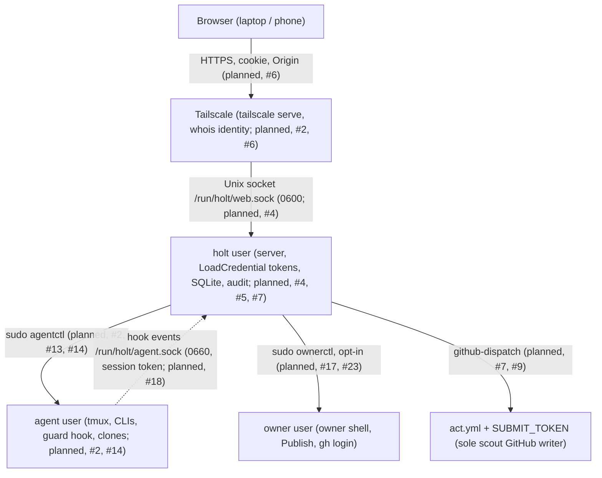

# Holt Threat Model

Status: **design baseline**. Only #1 (repo bootstrap) is complete; every Holt runtime control, script, and test below is **planned** until its linked issue lands. Verified `oss-scout` facts are noted explicitly.

## 1. What Holt protects

- **Ability to post on GitHub**: in `oss-scout`, the only GitHub writer is `act.yml` in the data repo (`oss-scout` README, "Guardrails"), using `SUBMIT_TOKEN`, which never leaves that repo's Actions secrets. The Worker accepts a fixed `ACTIONS` list (`worker/src/index.js`) and `scout/act.py` re-checks every action; Holt reuses that contract (planned, #9).
- **Holt's service tokens**: two fine-grained GitHub tokens (`github-read` for Contents read-only on `oss-scout-data`; `github-dispatch` for Actions read/write only) and the write-only `ntfy-token`, loaded as root-owned systemd credentials (planned, #7).
- **Owner's `gh` login and SSH keys**: kept only in the separate owner Unix user's home directory (`0700`), used only by the opt-in owner shell and Publish flow (planned, #17, #23).
- **Agent CLI logins**: Claude Code and Codex credentials under the `agent` Unix user (planned, #2).
- **Session terminals**: shared PTYs attached to `agent` tmux sessions and the opt-in owner shell (planned, #14, #16, #17).
- **SQLite database and audit log**: `/var/lib/holt/holt.db` (`0600`) and its append-only, hash-chained `audit` table (planned, #4, #5).

## 2. Who or what could attack

- **Prompt-injected agent session**: issue text, comments, and briefings come from strangers and are treated as untrusted data, never instructions.
- **Malicious upstream build or test script**: arbitrary code executed inside an agent clone during build or test runs (also `.git` hooks/config traps planted in shared clones, mitigated by workspace audit and `holtgit`, planned, #13).
- **Another device on the tailnet**: any peer not matching the owner's allow-listed Tailscale login or lacking a pairing cookie (planned, #6).
- **Local process on the mini PC**: an unprivileged local process attempting to hit Holt's sockets, loopback, or tailnet IP (planned, #4, #6).
- **Stolen phone or browser cookie**: a lost device holding a paired `__Host-holt_session` cookie (mitigated by `holt-admin revoke` and 12-hour fresh-cookie gate for owner shell/Publish, planned, #6, #17, #23).
- **Malicious issue rendered in the web app (XSS / terminal escapes)**: script injection in issue text or OSC 52 clipboard escapes in terminal output (mitigated by `SafeMarkdown`, strict CSP, and OSC 52 blocking, planned, #6, #10, #16).

## 3. Trust boundaries

## 4. Who may do what

`Local process` means a non-root, non-owner process on the mini PC. Every `Blocked` cell lists its control and planned verification (`deploy/verify-boundary.sh` from #2 and CI tests under `server/test/boundaries/` from #27).

| Action                    | Owner via web app                                                                                                                                     | `holt` user                                                                                                                                   | `agent` user                                                                                                                                                                      | Local process                                                                                                                                          | Other tailnet device                                                                                                                                        |
| ------------------------- | ----------------------------------------------------------------------------------------------------------------------------------------------------- | --------------------------------------------------------------------------------------------------------------------------------------------- | --------------------------------------------------------------------------------------------------------------------------------------------------------------------------------- | ------------------------------------------------------------------------------------------------------------------------------------------------------ | ----------------------------------------------------------------------------------------------------------------------------------------------------------- |
| Start `act.yml`           | Allowed (allowlisted actions via `POST /api/actions`; planned, #9, #26)                                                                               | Allowed (`github-dispatch`, allowlist + `scout/act.py` check; planned, #7, #9)                                                                | Blocked — no dispatch token, `web.sock` `0600`, guard hook (`deploy/verify-boundary.sh`, CI guard test; planned, #2, #6, #7, #27)                                                 | Blocked — `web.sock` `0600`, own-node check, no cookie/token (`deploy/verify-boundary.sh`, `server/test/boundaries/`; planned, #4, #6, #27)            | Blocked — tailnet `whois` allowlist + pairing cookie (`server/test/boundaries/`; planned, #6, #27)                                                          |
| Read the scout data       | Allowed (synced `dashboard.json` API; planned, #8)                                                                                                    | Allowed (read-only `github-read` clone at `/var/lib/holt/data-repo`; planned, #7, #8)                                                         | Blocked (full data; gets 1 briefing in `/srv/holt/briefings/<slug>`) — `/var/lib/holt` `0700` (`deploy/verify-boundary.sh`; planned, #2, #14)                                     | Blocked — `/var/lib/holt` `0700`, `web.sock` `0600`, own-node check (`deploy/verify-boundary.sh`, `server/test/boundaries/`; planned, #2, #4, #6, #27) | Blocked — tailnet `whois` allowlist + pairing cookie (`server/test/boundaries/`; planned, #6, #27)                                                          |
| Read tokens               | Blocked — API/UI/logs never expose tokens; `Secret` + `redact()` (`server/test/no-secrets.test.ts`, `server/test/boundaries/`; planned, #7, #10, #27) | Allowed (its 3 `LoadCredential` files only; planned, #7; never `SUBMIT_TOKEN` or owner `gh`)                                                  | Blocked — `/etc/holt/credentials` `0700` `root:root`, systemd `$CREDENTIALS_DIRECTORY`, `sudo env_reset` (`deploy/verify-boundary.sh`; planned, #2, #7, #14)                      | Blocked — `/etc/holt/credentials` `0700` `root:root` & systemd credential isolation (`deploy/verify-boundary.sh`; planned, #2, #7)                     | Blocked — tailnet allowlist + cookie; server never returns tokens (`server/test/boundaries/`; planned, #6, #7, #27)                                         |
| Open a terminal           | Allowed (agent terminal #16; opt-in owner shell needs fresh cookie + `.git` audit #17; planned)                                                       | Allowed (via `sudo agentctl attach` and opt-in `sudo ownerctl attach`; planned, #2, #14, #16, #17)                                            | Blocked (Holt / owner terminals) — `web.sock` `0600`, no sudo, `agent.sock` events-only (`deploy/verify-boundary.sh`; planned, #2, #6, #17, #18)                                  | Blocked — `web.sock` `0600`, own-node check, cookie + `Origin` (`deploy/verify-boundary.sh`, `server/test/boundaries/`; planned, #6, #16, #27)         | Blocked — tailnet allowlist, cookie + `Origin` (`server/test/boundaries/`; planned, #6, #16, #27)                                                           |
| Run `gh` write commands   | Allowed (via owner user only: opt-in owner shell #17 or Publish #23; planned)                                                                         | Blocked — no `gh` login, narrow GitHub tokens (`holt-admin credentials check`; planned, #7; owner writes require opt-in `ownerctl`, #17, #23) | Blocked — no `gh` login (user split) + root-owned guard hook (`guard/guard.py`) (`deploy/verify-boundary.sh`, CI guard test; planned, #2, #14, #27)                               | Blocked — owner `gh` config in owner `$HOME` `0700`; `ownerctl` limited to `holt` (`deploy/verify-boundary.sh`; planned, #2, #17, #23)                 | Blocked — tailnet allowlist, fresh cookie + `Origin` (`server/test/boundaries/`; planned, #6, #17, #23, #27)                                                |
| `git push`                | Allowed (via owner user only: opt-in owner shell #17 or Publish #23 with `holtgit`; planned)                                                          | Blocked — `data-repo` `pushurl=DISABLED`, read-only `github-read`, no SSH/write key (sync & cred tests; planned, #7, #8)                      | Blocked — no git write creds/SSH keys (user split) + root-owned guard hook (`deploy/verify-boundary.sh`, CI guard test; planned, #2, #14, #27)                                    | Blocked — owner SSH/git creds in owner `$HOME` `0700`; `ownerctl` limited to `holt` (`deploy/verify-boundary.sh`; planned, #2, #17, #23)               | Blocked — tailnet allowlist, fresh cookie + `Origin` (`server/test/boundaries/`; planned, #6, #23, #27)                                                     |
| Call Holt's HTTP API      | Allowed (tailnet identity + `__Host-holt_session` cookie + `Origin`; planned, #6)                                                                     | Allowed (`web.sock` owner `0600` / `holt-admin`; planned, #4, #6)                                                                             | Blocked — `web.sock` `0600`, own-node rule; `agent.sock` serves only `POST /internal/agent-event` (`deploy/verify-boundary.sh`, `server/test/boundaries/`; planned, #6, #18, #27) | Blocked — `web.sock` `0600`, no prod TCP listener, own-node rule (`deploy/verify-boundary.sh`, `server/test/boundaries/`; planned, #4, #6, #27)        | Blocked — tailnet allowlist + pairing cookie + `Origin` (`server/test/boundaries/`; planned, #6, #27)                                                       |
| Read another user's files | Blocked — API exposes only synced data, briefings, audit, archives (`server/test/boundaries/`; planned, #8, #14, #27; opt-in owner shell #17)         | Blocked — `/home/agent` `0750`, owner `$HOME` `0700`, systemd `ProtectHome=yes` (`deploy/verify-boundary.sh`; planned, #2, #4, #13)           | Blocked — `/var/lib/holt` & `/etc/holt/credentials` `0700`, owner `$HOME` `0700`, no sudo (`deploy/verify-boundary.sh`; Podman later, #29; planned, #2, #7)                       | Blocked — Unix `0700`/`0750` perms on homes, `/var/lib/holt`, `/etc/holt/credentials` (`deploy/verify-boundary.sh`; planned, #2, #4, #7)               | Blocked — UFW deny incoming outside `tailscale0`, tailnet allowlist + cookie (`deploy/verify-boundary.sh`, `server/test/boundaries/`; planned, #2, #6, #27) |

## 5. What the agent is not allowed to call

The `agent` user may never run **`gh` writes** (such as `gh pr create`, `gh issue comment`, or `gh api` writes), **`git push`**, **Holt's sockets** (`/run/holt/web.sock` is `0600` `holt`; `/run/holt/agent.sock` only accepts `POST /internal/agent-event` with a per-session token), or read **Holt's files** (`/var/lib/holt`, `/etc/holt`, `/etc/holt/credentials`, or the owner's `$HOME`).

Enforcement is **never a prompt** — two mechanical barriers stop an agent session from running `gh pr create` or `git push`:

1. **Unix user split (primary; planned, #2, #4, #7):** `agent` has no `gh` login, no git write tokens, no SSH keys, no `sudo`, and no read permission on Holt's or the owner's files and sockets.
2. **Managed guard hook (defense in depth for Claude Code; planned, #2, #14, #27):** `guard/guard.py` (which blocks GitHub writes for the cloud routine in `oss-scout`) is installed root-owned in `/usr/local/lib/holt/guard/` and registered in `/etc/claude-code/managed-settings.json`, where `agent` cannot edit or override it; blocked commands exit with code `2`.

## 6. Residual risks

- **Agent holds its own model login**: Claude Code and Codex logins live under `agent` and are readable by sessions (unavoidable; mounted read-only in rootless Podman later, planned, #2, #29).
- **Codex has no guard hook until #29**: for Codex sessions, the Unix user split is the only barrier until rootless Podman runs sessions from an image without `gh` (planned, #2, #29).
- **Owner shell is as powerful as the owner**: when enabled, it runs as the owner Unix user with the owner's `gh` login and SSH keys (and `holt` reaches it and Publish via narrow `sudo ownerctl` bridges, making `holt` a high-trust process; mitigated by default-off config, fresh-cookie age limit, and `.git` audit, planned, #13, #17, #23).
- **Tailnet login or paired browser equals the owner**: anyone controlling the allow-listed Tailscale login or a paired browser cookie is treated as the owner (mitigated by `holt-admin revoke` and the 12-hour cookie age check for owner shell/Publish, planned, #6, #17, #23).
- **Unrestricted outbound network from agent sessions**: a prompt-injected agent can still exfiltrate anything it can read (cloned code, its briefing, its model login) to any host reachable over outbound network (planned, #29 notes this explicitly).
- **Transcripts may contain private text**: live terminal output and raw transcripts can capture private text or secrets before archival redaction runs (or miss redaction patterns, planned, #19).

## 7. Out-of-scope threats

- Physical or root access to the mini PC.
- A compromised GitHub account.
- A compromised Tailscale control plane.

## 8. Last verified

- **Date:** 2026-11-26
- **Commit:** `b035c05` (design baseline after #1; update planned markers to passing tests in #27 and link from the finished README security section in #25).
